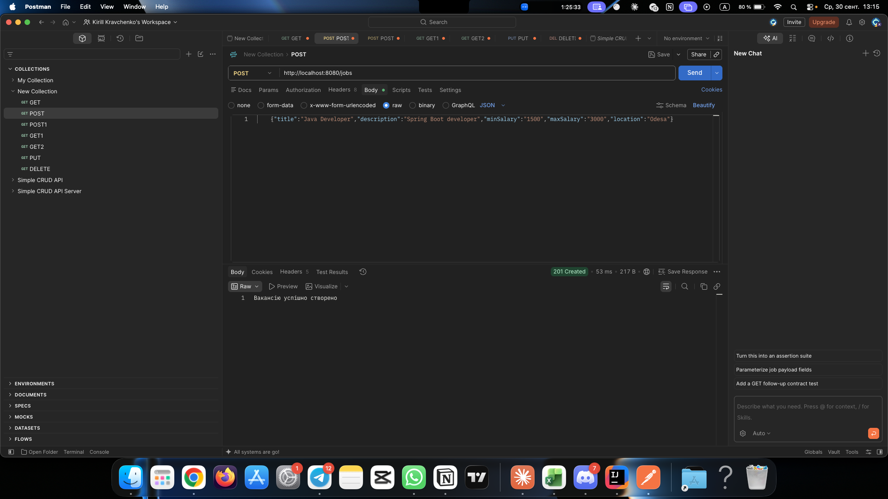
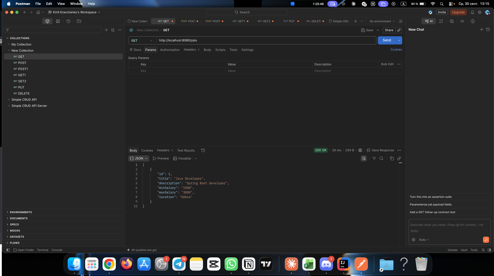
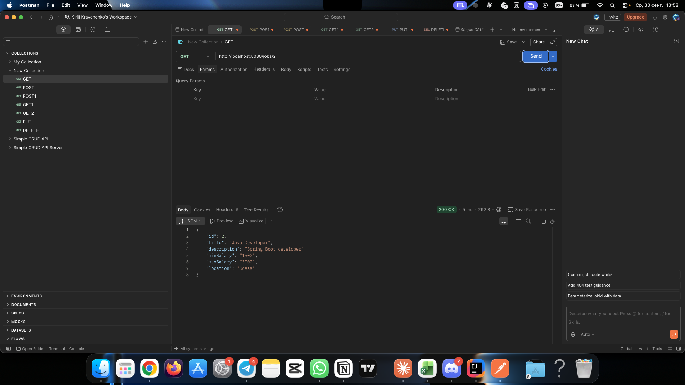
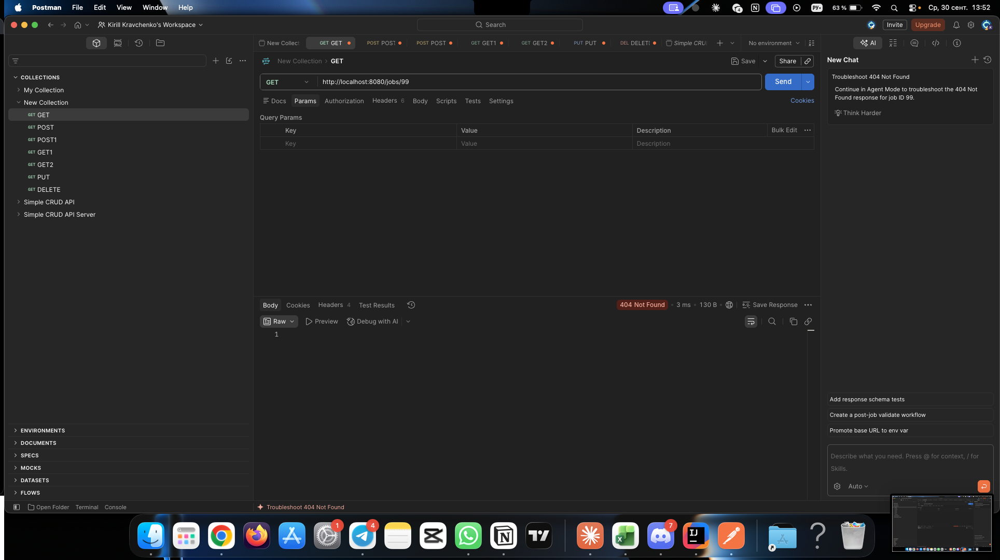
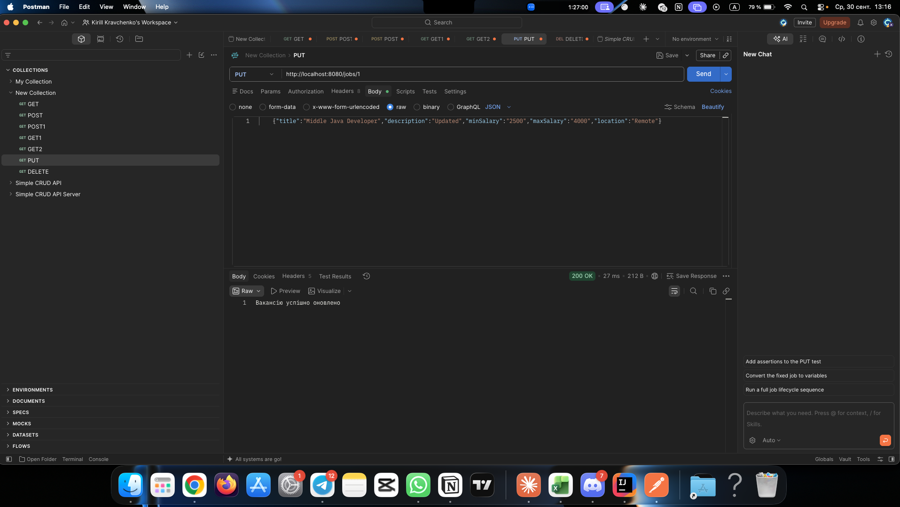
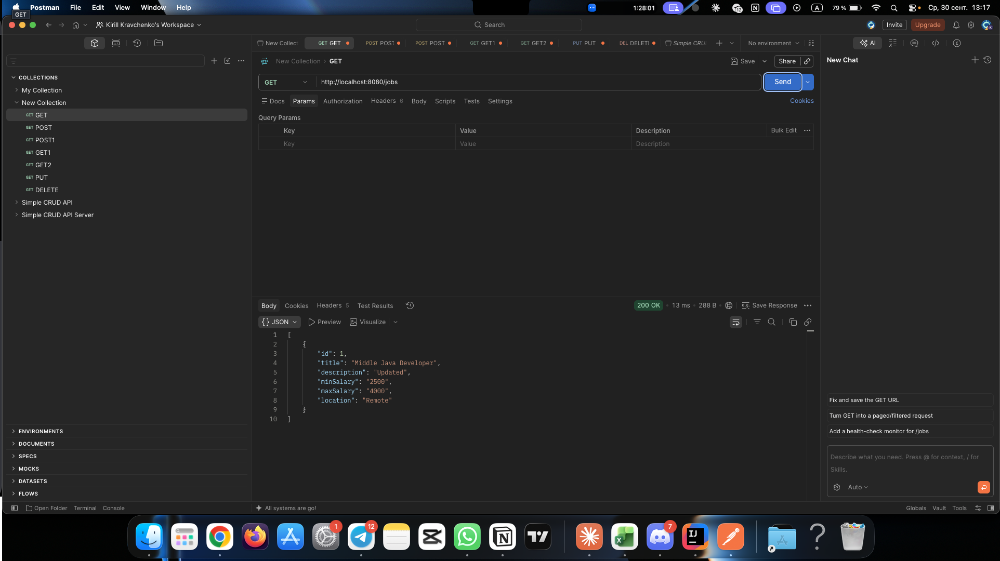

# Лабораторна робота № 3

**Дисципліна:** Архітектура клієнт-серверних застосувань

**Тема:** Створення REST API для управління вакансіями за допомогою Spring Boot

## Технології
- Java 21, Maven
- Spring Boot 4.1.1 (залежність Spring Web, вбудований Tomcat)
- Тимчасове сховище даних у пам'яті (`ArrayList`)
- Тестування: Postman

## Архітектура
Застосунок побудовано за трирівневою архітектурою:

| Рівень | Клас | Відповідальність |
|---|---|---|
| Controller | `JobController` | приймає HTTP-запити, формує відповіді через `ResponseEntity` |
| Service | `IJobService` + `JobService` | бізнес-логіка, зберігання вакансій, генерація ID |
| Model | `Job` | модель даних вакансії |

Сервіс впроваджується в контролер **через конструктор** (Dependency Injection).
Ідентифікатори вакансій генерує сам застосунок (поле `nextId` у сервісі), тому в тілі
запиту поле `id` вказувати не потрібно.

## Структура проєкту
```
src/main/java/com/example/jobapptutorial/
├── JobAppTutorialApplication.java   # точка входу Spring Boot
└── job/
    ├── Job.java                     # модель даних
    ├── IJobService.java             # інтерфейс сервісу
    ├── JobService.java              # реалізація (@Service)
    └── JobController.java           # контролер (@RestController)
```

## API

Базовий шлях задано анотацією `@RequestMapping("/jobs")` на рівні класу.

| Метод | Шлях | Тіло запиту | Відповідь |
|---|---|---|---|
| GET | `/jobs` | — | `200` — список усіх вакансій |
| POST | `/jobs` | `{"title": "...", "description": "...", "minSalary": "...", "maxSalary": "...", "location": "..."}` | `201` — «Вакансію успішно створено» |
| GET | `/jobs/{id}` | — | `200` — вакансія; `404` — не знайдено |
| PUT | `/jobs/{id}` | як у POST | `200` — «Вакансію успішно оновлено»; `404` |
| DELETE | `/jobs/{id}` | — | `200` — «Вакансію успішно видалено»; `404` |

## Запуск
```
mvn spring-boot:run
```
Застосунок стартує на порту `8080`, базова адреса: `http://localhost:8080/jobs`

## Використані анотації

| Анотація | Призначення |
|---|---|
| `@SpringBootApplication` | точка входу, автоконфігурація Spring Boot |
| `@RestController` | клас обробляє REST-запити, результат автоматично серіалізується у JSON |
| `@RequestMapping("/jobs")` | спільний базовий шлях для всіх методів контролера |
| `@GetMapping`, `@PostMapping`, `@PutMapping`, `@DeleteMapping` | прив'язка HTTP-методів до методів класу |
| `@PathVariable` | отримання значення `{id}` зі шляху запиту |
| `@RequestBody` | перетворення JSON із тіла запиту на об'єкт `Job` |
| `@Service` | клас містить бізнес-логіку, керується Spring як bean |

## Результати тестування у Postman









## Висновки
Створено повноцінний REST API для управління вакансіями на Spring Boot. Бізнес-логіку
винесено з контролера в сервісний рівень, що спрощує підтримку та тестування коду.
Реалізовано всі CRUD-операції, автоматичну генерацію ідентифікаторів та коректні
HTTP-статуси (`200 OK`, `201 Created`, `404 Not Found`) за допомогою `ResponseEntity`.
Дані зберігаються у пам'яті, тому очищуються при перезапуску застосунку; перехід до
постійного сховища заплановано в наступних роботах.
